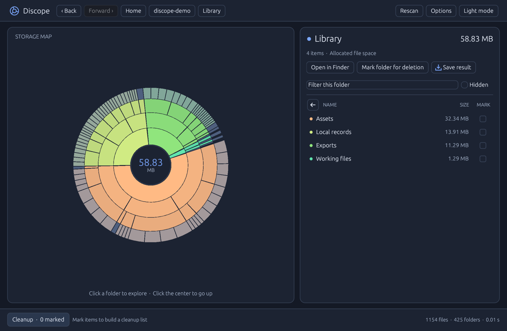

# Discope — Disk Usage Analyzer for macOS, Windows, and Linux

Discope is an open-source desktop app for finding what takes up disk space. Scan an internal drive, an external drive, or a folder, then drill into an interactive sunburst chart to see the largest files and folders. Export sizes to Excel or CSV, or review items for cleanup. Scans run locally.

## Download Discope

| Platform | Download | How to run |
| --- | --- | --- |
| macOS on Apple silicon | [Discope for macOS ARM64](https://github.com/noncent/discope/releases/latest/download/Discope-macOS-arm64.zip) | Extract the ZIP and open `Discope.app`. |
| Windows 10 or 11, 64-bit Intel or AMD | [Discope for Windows x64](https://github.com/noncent/discope/releases/latest/download/Discope-Windows-x64.zip) | Extract the ZIP and open `Discope.exe`. |
| Linux desktop, 64-bit Intel or AMD | [Discope for Linux x64](https://github.com/noncent/discope/releases/latest/download/Discope-Linux-x64.tar.gz) | Extract the archive and run `./discope` from the extracted directory. |

The macOS build is ad hoc signed. The Windows build is unsigned. Linux requires glibc 2.28 or later and a graphical desktop with OpenGL. Linux file dialogs use XDG Desktop Portal or Zenity. [Release notes and checksums](https://github.com/noncent/discope/releases/latest)



## Scan and explore disk space

- Choose **Scan a disk** or **Scan a folder** on Home, or drop a folder onto the window. On Windows and Linux, use the folder picker to select a drive root or mount point.
- Click a segment or folder to drill down without rescanning. Use the folder list’s back arrow to go up one level, or use **Open in Finder** on macOS to see the current folder.
- Reopen **Last scan** after relaunch. Use the **Hidden** filter, search by name, and switch between light and dark mode.
- Choose **Save result** to export the current folder’s files and subfolders as an Excel workbook or CSV. Reports include names, types, byte counts, and readable sizes. A subfolder’s size includes its contents.
- Mark items for cleanup, preview the list, and confirm **Move to Trash**. A reopened scan requires a fresh scan before cleanup.

## How sizes are counted

macOS and Linux report allocated file bytes and count hard-linked storage once per scan. Windows reports logical file lengths. Discope uses a macOS-specific scanner for APFS and shows available startup and mounted volumes. APFS snapshots, shared clone blocks, purgeable space, and separate volumes can affect comparisons with Finder. Entries that cannot be measured are marked unavailable. Discope reads local file metadata and keeps the latest scan index on the device.

## Build from source

Discope is written in Rust using egui. Use a current Rust toolchain and build from the repository directory.

On macOS, install the Xcode command-line tools, then run:

```sh
./build.sh
open target/release/Discope.app
```

On Windows, install the Visual Studio C++ build tools. On Linux, build in a desktop environment with X11 or Wayland and its graphics libraries. On either platform, run:

```sh
cargo run --release --locked
```

Use `--scan <folder>` with the executable to print a summary from the terminal.

## License

[MIT](LICENSE)
